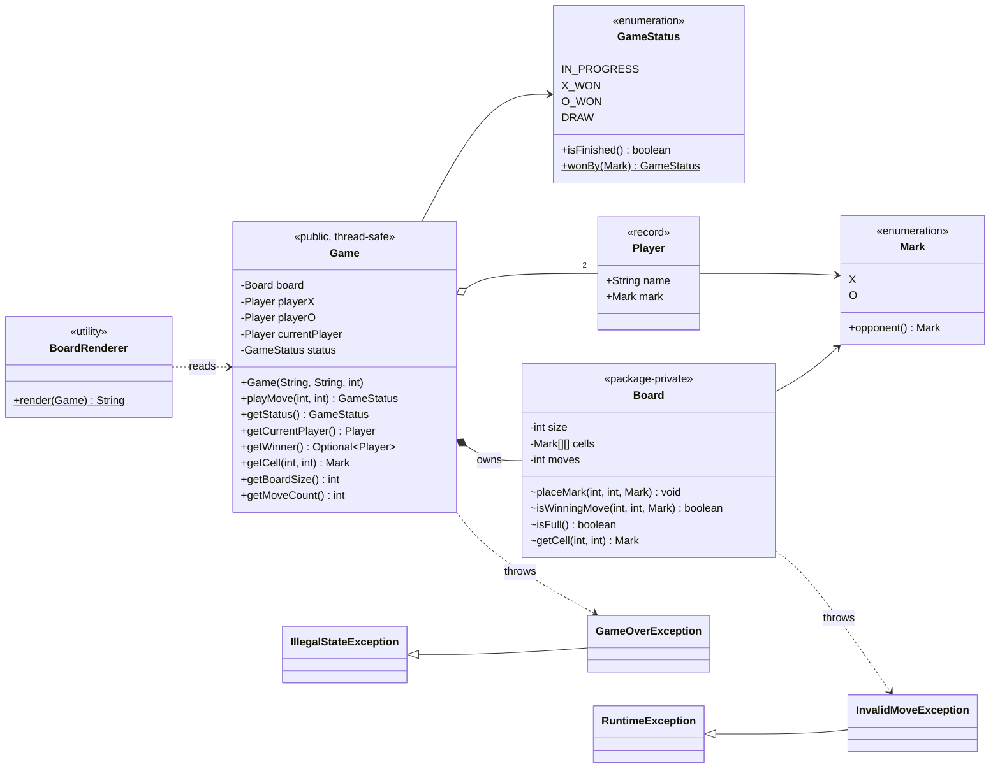
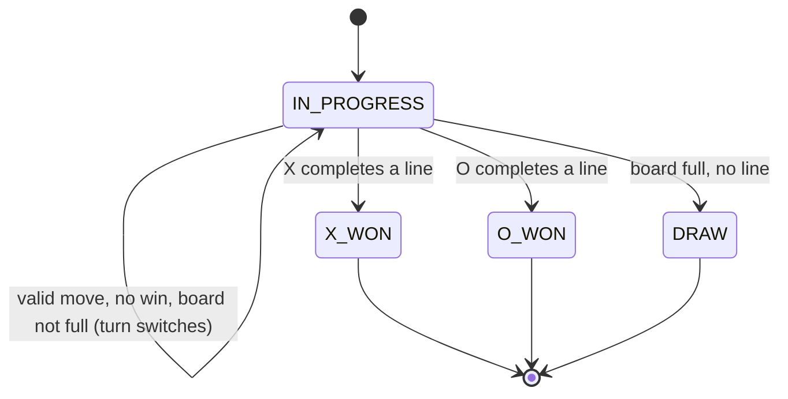
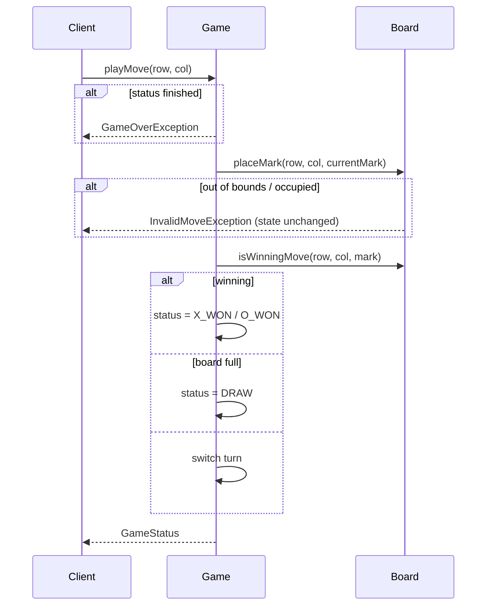

# Tic-Tac-Toe (Java)

**Author:** [vinu-varsidh](https://github.com/vinu-varsidh) — design and implementation.

An N x N Tic-Tac-Toe domain model with turn management, strict move validation, and O(N) win detection. The game logic is UI-agnostic; a small text renderer and a demo are included.

**Requirements:** Java 17+ (records, switch expressions).

## Quick start

With Maven:

```bash
mvn compile exec:java                                              # run demo
java -cp target/classes com.tictactoe.TicTacToeVerification        # run checks
```

Without Maven:

```bash
mkdir -p target/classes
find src/main/java -name '*.java' | xargs javac --release 17 -d target/classes
java -cp target/classes com.tictactoe.TicTacToeDemo
java -cp target/classes com.tictactoe.TicTacToeVerification
```

Expected demo output:

```
 X | X | X
---+---+---
 O | O |
---+---+---
   |   |
Status: X_WON
Winner: Alice
```

## Project layout

| Path | Role |
|------|------|
| `enums/` | `Mark` (X/O), `GameStatus` (IN_PROGRESS / X_WON / O_WON / DRAW) |
| `model/` | `Player` — immutable record (name + mark) with validation |
| `game/` | `Game` (public facade, turn + status) and `Board` (package-private grid + win detection) |
| `exception/` | `InvalidMoveException`, `GameOverException` |
| `view/` | `BoardRenderer` — text rendering, separate from the domain |
| `TicTacToeDemo` | Runnable example |
| `TicTacToeVerification` | Runnable checks (no test framework needed) |

All paths are under `src/main/java/com/tictactoe/`.

## Rules and invariants

- Coordinates are zero-based: `(0, 0)` is the top-left cell.
- X always moves first, and turns alternate only after an accepted move.
- A move is accepted only while the game is in progress and the target cell is in bounds and empty.
- A rejected move is atomic from the caller's perspective: the board, move count, status, and current player stay unchanged.
- A player wins by filling an entire row, column, or diagonal. On an N x N board this means N marks; shorter K-in-a-row rules are not implemented.
- A winning final move takes precedence over a draw.
- After a win or draw, the state is terminal and further moves throw `GameOverException`.

## Class diagram



## Game state machine



Invalid moves (occupied / out of bounds) are rejected **without** leaving `IN_PROGRESS` and **without** switching the turn.

## Move flow



## Design walkthrough

### One boundary owns the game

`Game` is the public facade for a match. It owns the two players, whose turn it is, and the current `GameStatus`. `Board` owns only the N x N grid, the accepted-move count, and line detection. This split keeps match orchestration separate from board mechanics without creating an interface for every class.

`Board` is package-private by design. If callers could place marks on it directly, they could bypass turn order and continue writing after a win. Keeping it behind `Game` makes one method, `playMove`, the consistency boundary. The cost is a handful of query methods on `Game`, but that duplication is preferable to exposing mutable state.

This is facade-style encapsulation rather than a large GoF pattern hierarchy: there is one simple entry point over a smaller internal object.

### A move either completes or changes nothing

`playMove` first rejects a terminal game. It then asks `Board` to place the current mark. `Board` validates the mark, coordinates, and occupancy before touching the array or move counter. Because mutation happens only after validation, an invalid move needs no rollback: the same player keeps the turn and every observable value remains unchanged.

The exception types preserve that distinction for clients. `InvalidMoveException` means the input can be corrected and retried; `GameOverException` means the match is terminal. Returning a `MoveResult` instead would make expected failures explicit, but it would add another public type and force callers to inspect it after every move. Exceptions keep this small API direct, at the cost of requiring clients to handle normal invalid-input paths.

After placement, `Game` checks for a win before checking whether the board is full. That order is important: when the final empty cell also completes a line, the result is a win rather than a draw. Only a non-terminal move switches the current player, so after the game ends `currentPlayer` still refers to the last mover.

### Win detection follows the last move

A new winning line must pass through the cell that was just filled. `Board` therefore scans only that row, that column, and either diagonal when the coordinates lie on it. A move takes O(N) time instead of rescanning all N² cells. Reading or placing a cell is O(1), draw detection is O(1), and rendering is O(N²). The board itself uses O(N²) space.

Per-row, per-column, and diagonal counters could reduce win detection to O(1), but they would duplicate more state and make each move harder to reason about. For a small turn-based board, the O(N) scan is the clearer tradeoff. The existing move counter is a smaller piece of duplicated state used to detect a draw in O(1); restricting all mutation to `Board` keeps that counter aligned with the grid.

The rule is intentionally "N in a row on an N x N board." Supporting K-in-a-row would introduce a real variation point and justify extracting a win-rule strategy. Until then, a `WinningStrategy` interface would add indirection without changing behavior.

### Thread safety sits at the same boundary

Every public method on `Game` is synchronized. This makes the full check-place-evaluate-switch sequence atomic and ensures readers observe a consistent status, player, move count, and board. `Board` needs no independent locking because it is accessible only through its owning `Game`.

The tradeoff is coarse serialization: even reads wait behind a move. Fine-grained locks or compare-and-set state could allow more concurrency, but they would complicate an object whose writes are naturally sequential turns. The single monitor favors correctness and auditability over throughput.

### Domain and presentation stay separate

`Player` is an immutable record, while `Mark` and `GameStatus` are enums. These are value-like domain objects with no setters or partial states. `BoardRenderer` sits outside the domain and only reads the `Game` API, so replacing console output with a web or GUI adapter does not change game rules.

There is no renderer interface yet because only one renderer exists. Likewise, the code does not use Factory, Observer, or AI Strategy patterns: object creation is trivial, nobody subscribes to moves, and move selection is outside the domain. Those abstractions become useful only when a second implementation or an actual extension requirement appears.

## Testing

`TicTacToeVerification` runs 16 scenarios containing 34 assertions. They cover both winners, every win direction, draws, a win on the final move, turn alternation, rejected moves, input validation, 1x1/4x4/5x5 boards, and concurrent submissions to a 10x10 game. It exits non-zero on any failure.

The concurrency scenario checks state consistency under contention; it is not a deterministic proof of every possible thread interleaving. The verification class is also not wired into Maven's `test` phase, so run it explicitly with the command in **Quick start**.

## Limitations and possible extensions

- **K-in-a-row** (e.g. 4 in a row on a 10x10 board) is not supported; a win requires a full line of N. Adding a `winLength` to `Board` would generalise this.
- **O(1) win detection** is possible with per-row/column/diagonal counters per mark, trading a little memory for constant-time checks.
- **Undo / move history** — record a `Move(player, row, col)` and add `undoLastMove()`.
- **AI player** — introduce a `PlayerStrategy` interface (random, minimax) selected per `Player`.
- **JUnit 5** — the verification checks can be ported directly for CI integration.
- **Board size** is unbounded; add an upper limit if it comes from untrusted input.
