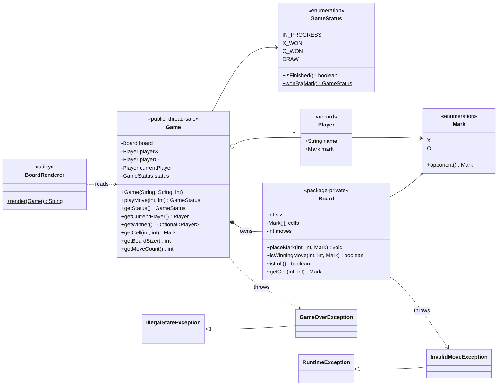
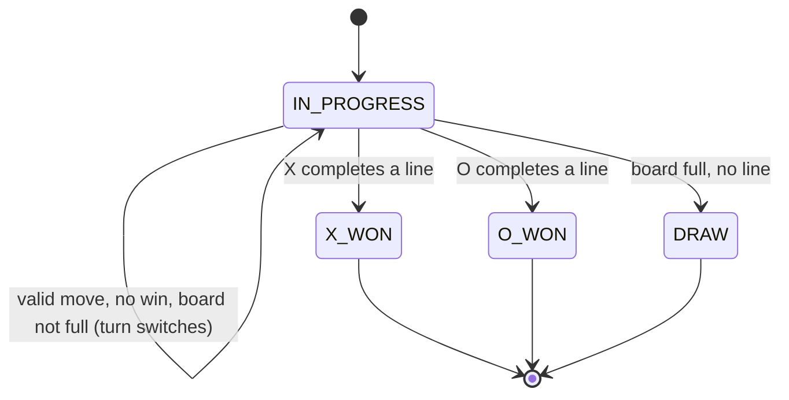
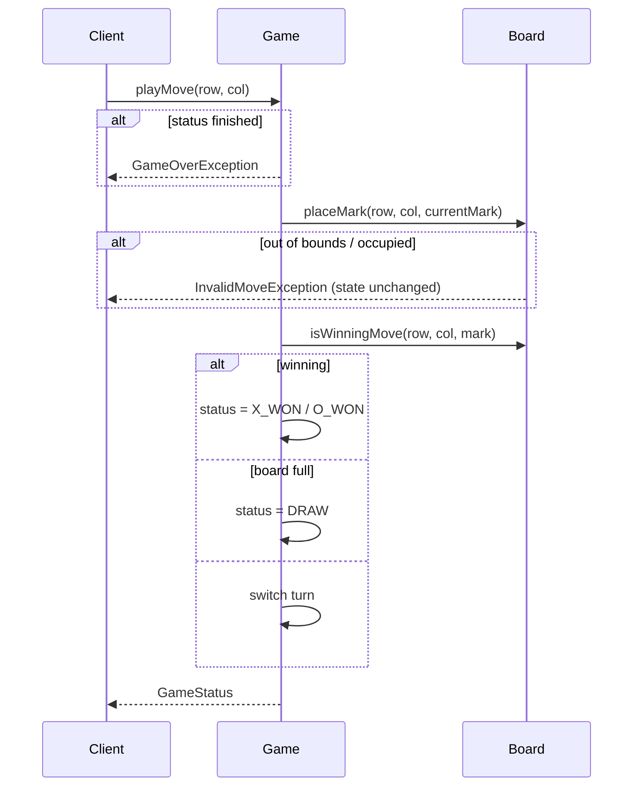

# Tic-Tac-Toe (Java)

**Author:** [vinu-varsidh](https://github.com/vinu-varsidh) — design and implementation.

An N x N Tic-Tac-Toe domain model with turn management, strict move validation, and O(N) win detection. The game logic is UI-agnostic; a small text renderer and a demo are included.

**Requirements:** Java 17+ (records, switch expressions).

## Quick start

With Maven:

```bash
mvn compile exec:java                                              # run demo
java -cp target/classes com.tictactoe.TicTacToeVerification        # run checks
```

Without Maven:

```bash
mkdir -p target/classes
find src/main/java -name '*.java' | xargs javac --release 17 -d target/classes
java -cp target/classes com.tictactoe.TicTacToeDemo
java -cp target/classes com.tictactoe.TicTacToeVerification
```

Expected demo output:

```
 X | X | X
---+---+---
 O | O |
---+---+---
   |   |
Status: X_WON
Winner: Alice
```

## Project layout

| Path | Role |
|------|------|
| `enums/` | `Mark` (X/O), `GameStatus` (IN_PROGRESS / X_WON / O_WON / DRAW) |
| `model/` | `Player` — immutable record (name + mark) with validation |
| `game/` | `Game` (public facade, turn + status) and `Board` (package-private grid + win detection) |
| `exception/` | `InvalidMoveException`, `GameOverException` |
| `view/` | `BoardRenderer` — text rendering, separate from the domain |
| `TicTacToeDemo` | Runnable example |
| `TicTacToeVerification` | Runnable checks (no test framework needed) |

All paths are under `src/main/java/com/tictactoe/`.

## Rules and invariants

- Coordinates are zero-based: `(0, 0)` is the top-left cell.
- X always moves first, and turns alternate only after an accepted move.
- A move is accepted only while the game is in progress and the target cell is in bounds and empty.
- A rejected move is atomic from the caller's perspective: the board, move count, status, and current player stay unchanged.
- A player wins by filling an entire row, column, or diagonal. On an N x N board this means N marks; shorter K-in-a-row rules are not implemented.
- A winning final move takes precedence over a draw.
- After a win or draw, the state is terminal and further moves throw `GameOverException`.

## Class diagram



## Game state machine



Invalid moves (occupied / out of bounds) are rejected **without** leaving `IN_PROGRESS` and **without** switching the turn.

## Move flow



## Design choices

| Choice / pattern | Why | Tradeoff considered |
|------------------|-----|---------------------|
| **`Game` facade over package-private `Board`** | Keeps turn/status rules separate from grid logic and prevents callers from bypassing invariants. | Requires small query delegates on `Game`; exposing `Board` would be more flexible but unsafe. |
| **Immutable values** (`Player` record and enums) | Prevents partial updates and keeps domain state simple. | New marks or statuses require code changes rather than configuration. |
| **Validate before mutation** | A rejected move leaves the board, count, status, and turn unchanged. | Exceptions are concise here; a result type would be more explicit but expand the API. |
| **Last-move win scan** | Only lines through the new mark can win: O(N) per move instead of O(N²). | Counters could reach O(1), but add state that must stay synchronized. |
| **Move counter for draws** | Detects a full board in O(1). | Duplicates grid information; encapsulated board mutation prevents drift. |
| **Win before draw** | A final move that completes a line is correctly classified as a win. | Ordering is behaviorally significant and must remain tested. |
| **Synchronized `Game` methods** | Makes each move and read atomic; `Board` needs no separate lock. | Serializes readers and writers, favoring simplicity over unnecessary throughput. |
| **Renderer outside the domain** | Console, GUI, or web presentation can change without touching game rules. | No renderer interface until a second implementation creates a real need. |

Strategy, Factory, and Observer were not added because the current rules, construction, and event flow have no corresponding variation point.

## Testing

`TicTacToeVerification` runs 16 scenarios containing 34 assertions. They cover both winners, every win direction, draws, a win on the final move, turn alternation, rejected moves, input validation, 1x1/4x4/5x5 boards, and concurrent submissions to a 10x10 game. It exits non-zero on any failure.

The concurrency scenario checks state consistency under contention; it is not a deterministic proof of every possible thread interleaving. The verification class is also not wired into Maven's `test` phase, so run it explicitly with the command in **Quick start**.

## Limitations and possible extensions

- **K-in-a-row** (e.g. 4 in a row on a 10x10 board) is not supported; a win requires a full line of N. Adding a `winLength` to `Board` would generalise this.
- **O(1) win detection** is possible with per-row/column/diagonal counters per mark, trading a little memory for constant-time checks.
- **Undo / move history** — record a `Move(player, row, col)` and add `undoLastMove()`.
- **AI player** — introduce a `PlayerStrategy` interface (random, minimax) selected per `Player`.
- **JUnit 5** — the verification checks can be ported directly for CI integration.
- **Board size** is unbounded; add an upper limit if it comes from untrusted input.
