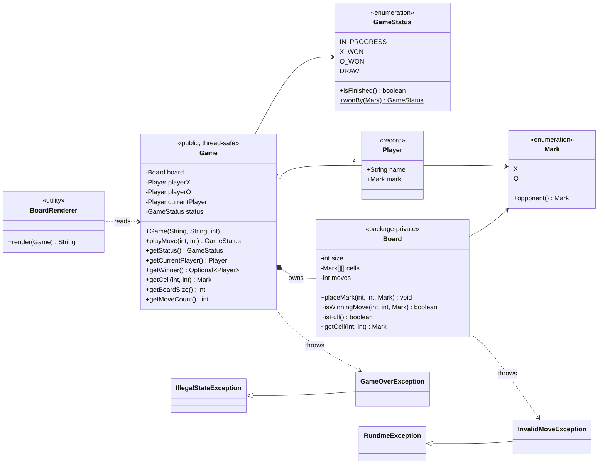
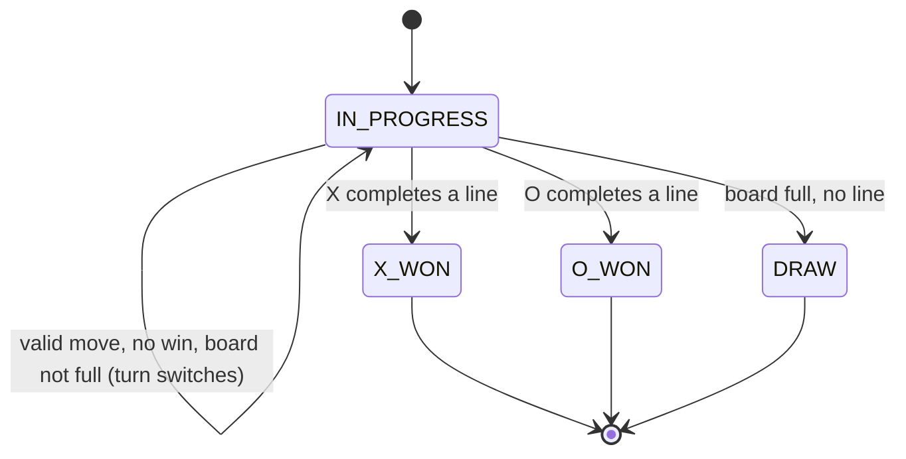
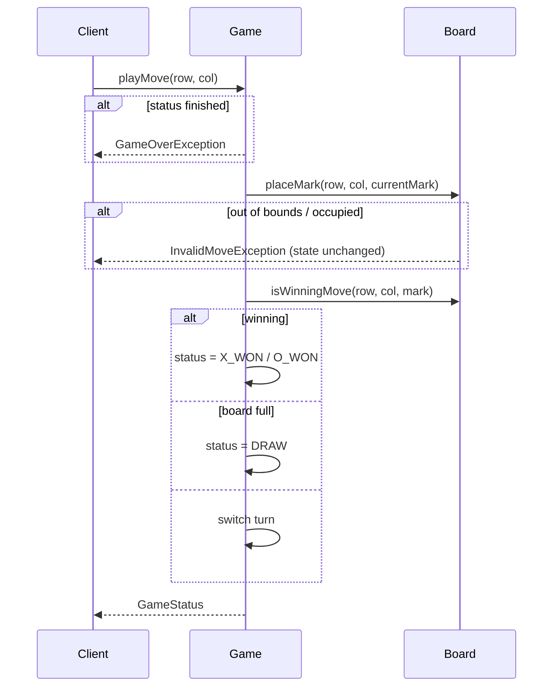

# Tic-Tac-Toe (Java)

**Author:** [vinu-varsidh](https://github.com/vinu-varsidh) — design and implementation.

An N x N Tic-Tac-Toe domain model with turn management, strict move validation, and O(N) win detection. The game logic is UI-agnostic; a small text renderer and a demo are included.

**Requirements:** Java 17+ (records, switch expressions).

## Quick start

With Maven:

```bash
mvn compile exec:java                                              # run demo
java -cp target/classes com.tictactoe.TicTacToeVerification        # run checks
```

Without Maven:

```bash
mkdir -p target/classes
find src/main/java -name '*.java' | xargs javac --release 17 -d target/classes
java -cp target/classes com.tictactoe.TicTacToeDemo
java -cp target/classes com.tictactoe.TicTacToeVerification
```

Expected demo output:

```
 X | X | X
---+---+---
 O | O |
---+---+---
   |   |
Status: X_WON
Winner: Alice
```

## Project layout

| Path | Role |
|------|------|
| `enums/` | `Mark` (X/O), `GameStatus` (IN_PROGRESS / X_WON / O_WON / DRAW) |
| `model/` | `Player` — immutable record (name + mark) with validation |
| `game/` | `Game` (public facade, turn + status) and `Board` (package-private grid + win detection) |
| `exception/` | `InvalidMoveException`, `GameOverException` |
| `view/` | `BoardRenderer` — text rendering, separate from the domain |
| `TicTacToeDemo` | Runnable example |
| `TicTacToeVerification` | Runnable checks (no test framework needed) |

All paths are under `src/main/java/com/tictactoe/`.

## Class diagram



## Game state machine



Invalid moves (occupied / out of bounds) are rejected **without** leaving `IN_PROGRESS` and **without** switching the turn.

## Move flow



## Design decisions

| Decision | Rationale |
|----------|-----------|
| **`Game` / `Board` split** | `Board` knows cells and lines only; `Game` knows players, turns and status. Each has one reason to change (SRP). |
| **`Board` is package-private** | Callers can only mutate state via `Game.playMove`, so turn order and status can never be bypassed. |
| **`Player` as a record** | Immutable value object; validation lives in the compact constructor, and the name is stripped. |
| **Win check only around the last move** | Only lines through the placed cell can become complete, so we check at most 4 lines: O(N) per move versus O(N²) for a full scan. |
| **Win is checked before draw** | A final move that fills the board *and* completes a line is a win, not a draw (covered by a check). |
| **Validate-then-mutate** | `placeMark` validates fully before writing, so a rejected move leaves board, turn and status untouched; the player can simply retry. |
| **Custom exceptions** | `InvalidMoveException` (recoverable, retry) and `GameOverException` (terminal) let callers react differently, unlike a generic `IllegalArgumentException`. |
| **`synchronized` on `Game`** | Check-then-act on turn/status is a race otherwise. One coarse lock is simple and correct for a 2-player game; `Board` stays lock-free because `Game` guards it. |
| **Rendering outside the domain** | `BoardRenderer` depends on `Game`, not vice versa, so a GUI or web layer can replace it without touching game logic. |
| **Configurable board size** | Win logic is size-agnostic (a full row/column/diagonal of N). Classic game = `new Game(x, o, 3)`. |

## Testing

`TicTacToeVerification` runs 34 checks covering all win directions, draws, a win on the final move, rejected moves, input validation, boards of several sizes, and concurrent play. It exits non-zero on any failure.

## Limitations and possible extensions

- **K-in-a-row** (e.g. 4 in a row on a 10x10 board) is not supported; a win requires a full line of N. Adding a `winLength` to `Board` would generalise this.
- **O(1) win detection** is possible with per-row/column/diagonal counters per mark, trading a little memory for constant-time checks.
- **Undo / move history** — record a `Move(player, row, col)` and add `undoLastMove()`.
- **AI player** — introduce a `PlayerStrategy` interface (random, minimax) selected per `Player`.
- **JUnit 5** — the verification checks can be ported directly for CI integration.
- **Board size** is unbounded; add an upper limit if it comes from untrusted input.
